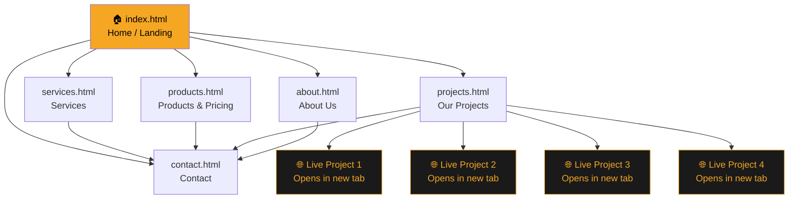
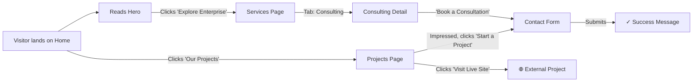
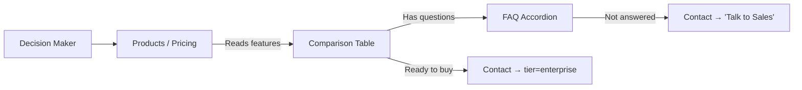
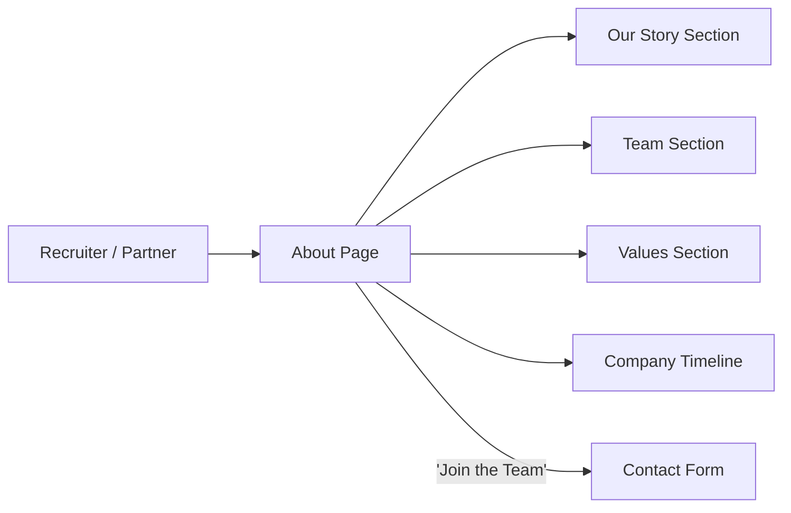
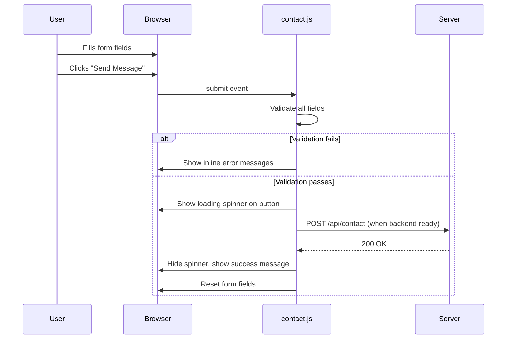
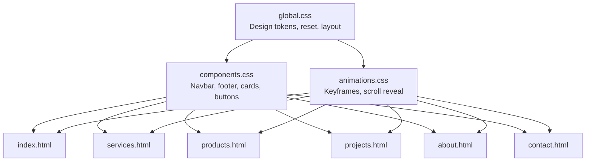
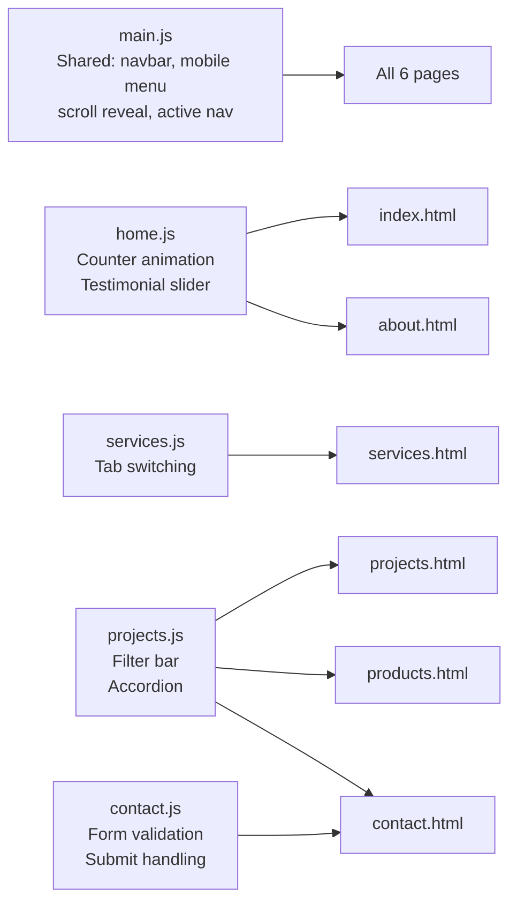

# Site Architecture & User Journey Flowchart

## Page Navigation Map

---

## User Journey Flows

### Journey 1: Visitor → Lead

### Journey 2: Decision Maker → Product Evaluation

### Journey 3: Recruiter / Partner → About Page

---

## Data Flow: Contact Form

---

## CSS Architecture

---

## JavaScript Architecture

